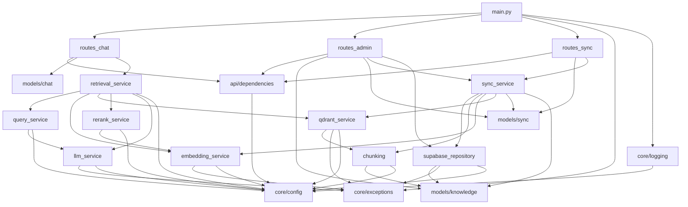

# Codebase Map

The primary debugging and maintenance guide: where every piece of code lives, which
direction dependencies flow, and how a request travels through the system. Read this
before changing anything; when you move code, update this file in the same change.

## 1. Layout

```text
app/
├── main.py                    Entry point: app object, CORS + request-id middleware, router mounting,
│                              exception handlers, health probes, /dataentry page, model preload
├── api/                       HTTP layer — thin; no business logic
│   ├── routes_chat.py         POST /api/v1/chat (+ in-process session memory), GET /chat/status,
│   │                          POST /chat/ask (deprecated v1 contract)
│   ├── routes_admin.py        /api/v1/admin/*: auth, logout, schema, entries CRUD, bulk import, sync + status
│   ├── routes_sync.py         POST /api/v1/webhook/sync (X-Webhook-Secret)
│   └── dependencies.py        Admin sessions (sign/verify), secret checks, SYNC_ENABLED switch, RateLimiter
├── core/                      Cross-cutting infrastructure — imports nothing from other app layers
│   ├── config.py              Settings (pydantic-settings): the ONLY place configuration is read
│   ├── exceptions.py          ExternalServiceError + exception handlers (the error contract)
│   └── logging.py             Log format with request id on every line
├── models/                    Pydantic schemas — pure data, no imports from the app
│   ├── knowledge.py           KnowledgeEntryIn / KnowledgeEntry + the 7 categories: the ONE schema behind table, payload and grid
│   ├── chat.py                ChatRequest/ChatResponse/Source, legacy ChatAsk*, ErrorResponse
│   └── sync.py                SyncReport, SyncStatus
├── services/                  Business logic — framework-agnostic (no FastAPI imports)
│   ├── retrieval_service.py   RAG orchestrator: answer_question, fusion, evidence gate, context, citations
│   ├── query_service.py       Query planning: follow-up rewrite, "list all X" routing over index categories
│   ├── embedding_service.py   Local models (FastEmbed): dense + BM25 vectors, embedding version, model cache
│   ├── qdrant_service.py      Vector store: collection schema, chunk upserts/deletes, category facets, hybrid query
│   ├── rerank_service.py      Optional cross-encoder reranking (off by default)
│   ├── llm_service.py         Groq over HTTPS: persona + fixed grounding rules, retries, Retry-After
│   ├── chunking.py            Entries → chunks: normalise, split long content, fingerprint, embedding text
│   ├── supabase_repository.py SupabaseRepository: async CRUD + bulk upsert over Supabase REST (PostgREST)
│   └── sync_service.py        KnowledgeSyncService: fetch → chunk → diff fingerprints → embed changed → delete/upsert
└── web/                       Admin studio (served at /dataentry, no build step)
    ├── dataentry.html         Markup + Tailwind (CDN); {{APP_TITLE}}/{{API_PREFIX}} filled in by main.py
    └── dataentry.js           ES module: login, tabbed spreadsheet grid (edit, add, reorder, paste, save), bulk import, sync, chat tester
supabase/schema.sql            portfolio_knowledge_base table, 7-category CHECK, indexes, trigger, RLS, per-tab views — run once
data/sample_entries.json       Neutral sample (a fictional portfolio across all 7 tabs) for first runs and benchmarks
tests/
├── conftest.py                offline guard (blanks every service URL/key), fake_models, indexed_client
├── test_admin.py              admin auth, schema, CRUD, bulk import, mocked Supabase → Qdrant sync, /dataentry
├── test_api_chat.py           chat contract, sessions, legacy alias, health, error handling, rate limit
├── test_api_sync.py           webhook auth and behaviour
├── test_services.py           one section per service (mirrors app/services/)
└── test_benchmarks.py         metric maths + real-model retrieval-quality gate (RUN_MODEL_TESTS=1)
benchmarks/                    eval-cases.json (labels for the sample), metrics.py, evaluate.py (runner)
scripts/                       initialize_qdrant.py, manual_sync.py (CLI equivalents of admin calls)
docs/                          architecture assessment, benchmark baseline, improvement roadmap
Dockerfile, render.yaml        container image; Render blueprint. requirements*.txt pin dependencies.
.github/workflows/             ci.yml (lint, tests, quality gate), sync.yml (scheduled webhook call)
private/                       (gitignored) anything personal, e.g. your own benchmark corpus
```

## 2. Layer rules

| Layer | Owns | Must not |
|---|---|---|
| `api/` | URL paths, HTTP methods, auth/rate-limit dependencies, request validation via schemas, OpenAPI docs | contain business logic, call Qdrant/Supabase/LLM directly, catch service errors (handlers do that) |
| `services/` | All behaviour: retrieval, generation, sync, talking to Qdrant/Supabase/LLM/models | import FastAPI or `app.api`; read `os.environ` (use `settings`) |
| `models/` | Request/response/entry shapes and their validation limits | import anything from the app; contain logic beyond field validation |
| `core/` | Settings, error types + handlers, logging setup | depend on `api/`, `services/` or `models/` |
| `web/` | Presentation only | hold data or secrets (everything comes from the admin API) |

Dependency direction is strictly downward:



The only edges from `services/` into `models/` are the entry schema (`knowledge.py`) and the
sync report (`sync.py`). No service imports `api/`; `core/` and `models/` import nothing from the app.

## 3. Request flow: `POST /api/v1/chat`

```mermaid
sequenceDiagram
    autonumber
    participant C as Client
    participant M as main.py middleware
    participant R as routes_chat.chat
    participant D as dependencies
    participant RS as retrieval_service
    participant QS as query_service
    participant E as embedding_service
    participant Q as qdrant_service
    participant RR as rerank_service
    participant L as llm_service

    C->>M: POST /api/v1/chat {message, session_id?, history?}
    M->>M: assign X-Request-ID (log context)
    M->>R: route
    R->>D: chat_rate_limit (429 + Retry-After if exceeded)
    R->>R: validate body (422); history = body.history or session memory
    R->>RS: answer_question(message, history)
    RS->>Q: list_categories (facet, cached 5 min; failure → last known list)
    RS->>QS: plan_query(message, history, categories)
    opt follow-up with history
        QS->>L: complete(rewrite prompt) → standalone query
    end
    QS-->>RS: QueryPlan(retrieval_query, categories, list_mode)
    RS->>E: embed_query + embed_sparse_query (local, ~10 ms)
    RS->>Q: query_candidates — dense + BM25 (+ category) in ONE round-trip
    Q-->>RS: ranked chunks per retriever
    RS->>RS: fuse (RRF, per chunk) → candidates
    opt RERANKER_MODEL set
        RS->>RR: rerank (falls back to fusion order on failure)
    end
    RS->>RS: select (evidence gate + top-k) → build_context (token budget)
    alt nothing passes the gate
        RS-->>R: NO_ANSWER_MESSAGE, no LLM call
    else evidence found
        RS->>L: generate_answer(question, numbered sources) — persona + grounding rules
        L-->>RS: reply with [n] citations (retries 429/5xx with backoff)
        RS->>RS: apply_citations (renumber, keep only cited chunks)
    end
    RS->>RS: log one `rag_request` line (timings, counts — no question text)
    RS-->>R: {reply, sources[, debug]}
    R->>R: remember the exchange under session_id
    R-->>C: 200 ChatResponse {reply, sources, session_id, latency_ms}
```

An `ExternalServiceError` from embedding, the Qdrant query or generation skips the rest and
becomes **503 + Retry-After** in `core/exceptions.py`. A failed category lookup, follow-up
rewrite or rerank does *not* fail the request: each falls back (last categories, original
question, fusion order).

## 4. Admin flow: `/dataentry` and `/api/v1/admin/*`

1. `GET /dataentry` serves `web/dataentry.html` (title/prefix filled in, framing denied); the
   module calls `GET /admin/schema` — a 401 shows the login gate.
2. `POST /admin/auth` → `check_admin_password` (constant time; `login_rate_limit` 5/min/IP) →
   `issue_session_token` → HttpOnly SameSite=Strict cookie scoped to `/api/v1/admin`.
3. Every other admin route depends on `require_admin` (`session_is_valid`: HMAC + expiry).
4. CRUD routes call `SupabaseRepository` (via `get_repository`, the same instance the sync uses).
   `DuplicateEntryError` → 409, missing row → 404, `SupabaseServiceError` → 503 **with** its
   actionable message (`expose = True`).

## 5. Sync flow: `POST /admin/sync` (and `/webhook/sync`)

```mermaid
sequenceDiagram
    autonumber
    participant A as Admin UI / GitHub Actions / Supabase webhook
    participant RT as routes_admin / routes_sync
    participant S as KnowledgeSyncService
    participant SB as SupabaseRepository
    participant CH as chunking
    participant E as embedding_service
    participant Q as qdrant_service

    A->>RT: POST /admin/sync (cookie) or /webhook/sync (X-Webhook-Secret)
    RT->>S: run() — returns at once if a sync is already running
    S->>SB: list_entries(active_only) — stage "fetching" (pages past 1000 rows)
    S->>S: worker thread from here (chat keeps serving)
    S->>CH: build_chunks (dedupe, split, entry fingerprint)
    S->>Q: ensure_collection (recreate if vector schema changed; add missing indexes)
    S->>Q: scan_index → fingerprints per entry (+ legacy points to delete)
    S->>S: diff → changed (new/edited/partial) and removed entries
    S->>E: embed_documents + embed_sparse_documents — stage "embedding" (changed only)
    S->>Q: delete_entries(changed ∪ removed) then upsert_chunks — stage "upserting"
    S->>Q: clear_category_cache
    S-->>RT: SyncReport(total_entries, chunks_embedded, vectors_upserted, added, updated, removed, unchanged, duration_ms)
```

The UI polls `GET /admin/sync` while the POST is in flight to show the live stage. Sync never
raises to the client: failures come back as `{"success": false, "error": ...}`.

## 6. Error contract

Every error body is `{"success": false, "error": "<message>"}` (`models/chat.ErrorResponse`);
422s add `details: [{"field", "message"}]` built by `core/exceptions._field_error` (never the input values).

| Status | Raised by | Cause |
|---|---|---|
| 401 | `api/dependencies` | wrong admin password / webhook secret; missing, forged or expired session |
| 403 | `api/dependencies.require_sync_enabled` | `SYNC_ENABLED=false` |
| 404 / 409 | `api/routes_admin` | entry not found / id already exists |
| 422 | FastAPI validation → `core/exceptions` | body or path violates `models/` limits |
| 429 | `api/dependencies.RateLimiter` | over the chat or login limit (with `Retry-After`) |
| 503 | `_check_secret` / `require_admin` | admin password or webhook secret not configured |
| 503 | any `ExternalServiceError` subclass → `core/exceptions` | Qdrant, embedding, Groq (carries provider `Retry-After`), Supabase (message exposed) |
| 500 | `core/exceptions._unhandled_error` | a bug — stack trace logged, never returned |

## 7. Debugging guide

Every response has `X-Request-ID`; every log line for that request carries the same id
in `[brackets]`. Chat requests log one line:

```text
INFO [3f2a9c...] app.services.retrieval_service: rag_request {"plan_ms": 2.1, "embed_ms": 12.1, "search_ms": 301.2,
  "retrievers": {"dense": 20, "sparse": 20}, "selected": 5, "top_score": 0.67, "llm_ms": 1387.6,
  "total_ms": 1701.3, "refused": false, "rewritten": false, "list_mode": false, ...}
```

Syncs log one `sync {...}` line with the report. For a full chat trace (candidates,
per-retriever ranks, scores, what passed the gate) set `RAG_DEBUG=true` locally.

| Symptom | Look at |
|---|---|
| 503 on every chat request | `/api/v1/health`, then `qdrant_service.query_candidates` (collection missing → sync), then `llm_service` (key) |
| Every answer is "not available" | log `No indexed chunks for the current embedding version` → models changed or never synced; else `retrieval_service.select` thresholds |
| Right entry exists but isn't cited | `RAG_DEBUG` → in `candidates`? No → `embedding_service` / `query_service` routing / tags; yes but not `selected` → `select` gate; selected but uncited → prompt in `llm_service` |
| "List all X" misses entries | `query_service.route_categories` — does the question name the category (or its last word) in plural, or use list/all/every? |
| Follow-up misunderstood | `query_service.needs_rewrite` / `rewrite_query` (`rewritten` flag in the log) |
| Raw `【1】` or wrong `[n]` in replies | `retrieval_service.apply_citations` |
| Sync `success: false` | the `error` field: Supabase setup → `supabase_repository._error_message` |
| Sync re-embeds everything each run | `embedding_service.embedding_version` changed, or fingerprint inputs in `chunking.build_chunks` |
| Admin keeps signing out | process restarted (per-process session secret in `api/dependencies`) |
| 401 on webhook from GitHub Actions | `SYNC_WEBHOOK_SECRET` (repo secret) must equal `WEBHOOK_SECRET` (server) |
| Slow first request after idle | cold start; `main.lifespan` preloads models in the background |

## 8. Where to add things

| Change | Touch |
|---|---|
| New column | `models/knowledge.py` (the grid adds a column automatically) → `supabase/schema.sql` → `chunking` if it should be embedded or fingerprinted |
| Different categories | the `Category` literal + `ID_PREFIXES` in `models/knowledge.py` → CHECK constraint and views in `supabase/schema.sql` (a test checks they match) |
| New endpoint | `api/routes_*.py` (+ schema in `models/`, logic in `services/`, test in `tests/`) |
| New setting | `core/config.py` → `.env.example` → README configuration table |
| New knowledge source | something returning `KnowledgeEntryIn`s; give `KnowledgeSyncService` a repository with `list_entries` |
| New retriever | a request in `qdrant_service.query_candidates`; fusion picks it up automatically by name |
| New external dependency error | subclass `ExternalServiceError` in its service → automatic 503 (set `expose` only for safe messages) |
| Retrieval/prompt change | run `python -m benchmarks.evaluate` before and after; keep `tests/test_benchmarks.py` green |

## 9. Tests at a glance

| Test file | Covers |
|---|---|
| `test_admin.py` | every admin route needs a session; cookie flags; forged/expired tokens; password change; login limit; CRUD; bulk import (incl. view-style `"TRUE"/"FALSE"`); mocked Supabase → in-memory Qdrant sync; stages; concurrency; /dataentry headers and escaping |
| `test_api_chat.py` | chat contract, sessions, explicit history, legacy alias, health, error handlers, rate limit, request id |
| `test_api_sync.py` | webhook auth, SYNC_ENABLED |
| `test_services.py` | entry schema (and its match with the SQL CHECK + views), chunking, supabase_repository, qdrant_service, embedding_service, query_service, retrieval_service, sync indexing, rerank_service, citations, answer_question, llm_service |
| `test_benchmarks.py` | metric maths; with `RUN_MODEL_TESTS=1`, the retrieval-quality floors |

`pytest` runs fully offline — the autouse `offline` fixture blanks every service URL and key,
so a developer's `.env` can never be reached. `RUN_MODEL_TESTS=1 pytest` adds real-model checks.
