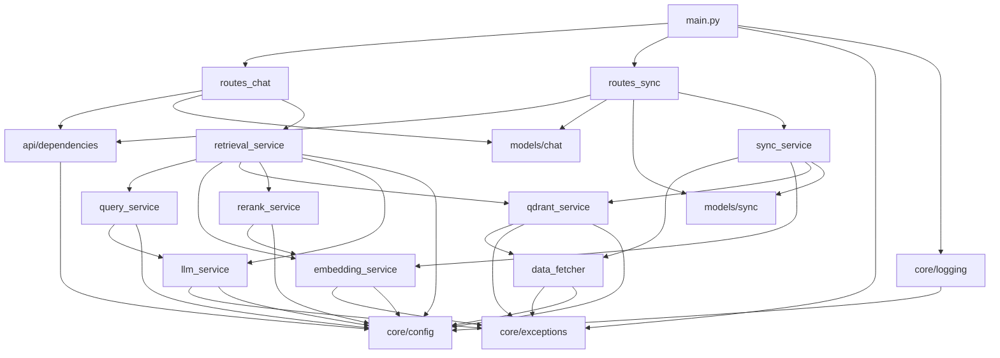
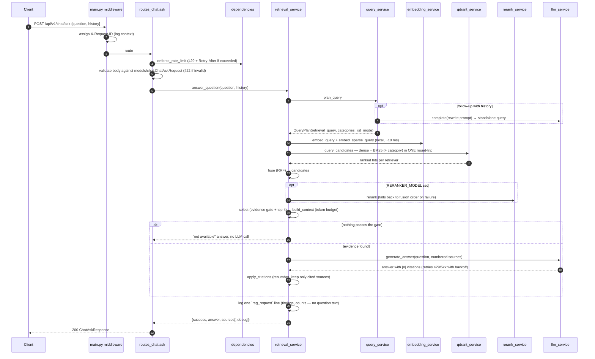
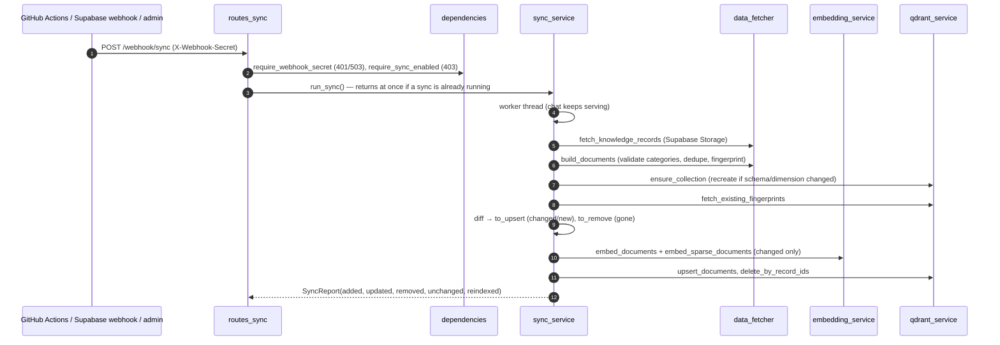

# Codebase Map

The primary debugging and maintenance guide: where every piece of code lives, which
direction dependencies flow, and how a request travels through the system. Read this
before changing anything; when you move code, update this file in the same change.

## 1. Layout

```text
app/
├── main.py                    Entry point: app object, CORS + request-id middleware,
│                              router mounting, exception handlers, health probes, model preload
├── api/                       HTTP layer — thin; no business logic
│   ├── routes_chat.py         GET /api/v1/chat/status, POST /api/v1/chat/ask
│   ├── routes_sync.py         POST /api/v1/webhook/sync (X-Webhook-Secret), POST /api/v1/admin/sync (x-admin-token)
│   └── dependencies.py        FastAPI dependencies: secret checks, SYNC_ENABLED switch, per-IP rate limit
├── core/                      Cross-cutting infrastructure — imports nothing from other app layers
│   ├── config.py              Settings (pydantic-settings): the ONLY place configuration is read
│   ├── exceptions.py          ExternalServiceError + exception handlers (the error contract)
│   └── logging.py             Log format with request id on every line
├── models/                    Pydantic schemas — pure data, no imports from the app
│   ├── chat.py                ChatTurn, ChatAskRequest, Source, ChatAskResponse, ErrorResponse
│   └── sync.py                SyncReport
└── services/                  Business logic — framework-agnostic (no FastAPI imports)
    ├── retrieval_service.py   RAG orchestrator: answer_question, fusion, evidence gate, context, citations
    ├── query_service.py       Query planning: follow-up rewrite, "list all X" category routing
    ├── embedding_service.py   Local models (FastEmbed): dense + BM25 vectors, embedding version, model cache
    ├── qdrant_service.py      Vector store: collection schema, upserts, deletes, batched hybrid query
    ├── rerank_service.py      Optional cross-encoder reranking (off by default)
    ├── llm_service.py         Groq / Gemini over HTTPS: grounding prompt, retries, Retry-After
    ├── data_fetcher.py        Knowledge-base source: Supabase download, validation, Document model
    └── sync_service.py        Sync orchestrator: fetch → diff fingerprints → embed changed → upsert/delete
tests/
├── conftest.py                fake_models (deterministic embedder) and indexed_client (in-memory Qdrant)
├── test_api_chat.py           chat + health endpoints, error handling, rate limit, request id
├── test_api_sync.py           webhook + admin sync endpoints
├── test_services.py           one section per service (mirrors app/services/)
└── test_benchmarks.py         metric maths + real-model retrieval-quality gate (RUN_MODEL_TESTS=1)
benchmarks/                    labelled dataset (rag-evaluation.json), corpus snapshot, metrics, runner, results
scripts/                       initialize_qdrant.py, manual_sync.py (CLI equivalents of admin calls)
docs/                          architecture assessment, benchmark baseline, improvement roadmap
examples/                      sample knowledge-base file for new deployments
postman/                       Postman collection with built-in tests
app.py                         local dev runner (`python app.py`); Render runs uvicorn directly
render.yaml, requirements*.txt deployment + dependency pins; pyproject.toml tool config (ruff, pytest)
.github/workflows/             ci.yml (lint, tests, quality gate), sync.yml (scheduled webhook call)
```

## 2. Layer rules

| Layer | Owns | Must not |
|---|---|---|
| `api/` | URL paths, HTTP methods, auth/rate-limit dependencies, request validation via schemas, OpenAPI docs | contain business logic, call Qdrant/LLM directly, catch service errors (handlers do that) |
| `services/` | All behaviour: retrieval, generation, sync, talking to Qdrant/Supabase/LLM/models | import FastAPI or `app.api`; read `os.environ` (use `settings`) |
| `models/` | Request/response shapes and their validation limits | import anything from the app; contain logic |
| `core/` | Settings, error types + handlers, logging setup | depend on `api/`, `services/` or `models/` |

Dependency direction is strictly downward — verified from the code's imports:



The single cross-layer edge is `sync_service → models/sync` (sync returns its report
schema). No service imports `api/`; `core/` and `models/` import nothing from the app.

## 3. Request flow: `POST /api/v1/chat/ask`



An `ExternalServiceError` from embedding (step 10), the Qdrant query (11) or answer
generation (17) skips the rest and becomes **503 + Retry-After** in `core/exceptions.py`.
A failed follow-up rewrite (8) and a failed rerank (14) do *not* fail the request: they
fall back to the original question and the fusion order respectively.

## 4. Sync flow: `POST /api/v1/webhook/sync` (and `/admin/sync`)



Sync never raises to the client: failures come back as `{"success": false, "error": ...}`.

## 5. Error contract

Every error body is `{"success": false, "error": "<message>"}` (`models/chat.ErrorResponse`);
422s add `details: [{"field", "message"}]` built by `core/exceptions._field_error` (never the input values).

| Status | Raised by | Cause |
|---|---|---|
| 401 / 503 | `api/dependencies._check_secret` | wrong secret / secret not configured on the server |
| 403 | `api/dependencies.require_sync_enabled` | `SYNC_ENABLED=false` |
| 422 | FastAPI validation → `core/exceptions` | body violates `models/` limits |
| 429 | `api/dependencies.enforce_rate_limit` | over `RATE_LIMIT_PER_MINUTE` (with `Retry-After`) |
| 503 | any `ExternalServiceError` subclass → `core/exceptions` | `QdrantServiceError`, `EmbeddingServiceError`, `LLMServiceError` (carries provider `Retry-After`), `SupabaseServiceError` |
| 500 | `core/exceptions._unhandled_error` | a bug — stack trace logged, never returned |

## 6. Debugging guide

Every response has `X-Request-ID`; every log line for that request carries the same id
in `[brackets]`. Chat requests log one line:

```text
INFO [3f2a9c...] app.services.retrieval_service: rag_request {"embed_ms": 12.1, "search_ms": 301.2,
  "retrievers": {"dense": 20, "sparse": 20}, "selected": 5, "top_score": 0.67, "llm_ms": 1387.6,
  "total_ms": 1701.3, "refused": false, "rewritten": false, "list_mode": false, ...}
```

For a full trace (candidates, per-retriever ranks, scores, what passed the gate) set
`RAG_DEBUG=true` locally and read `debug` in the response.

| Symptom | Look at |
|---|---|
| 503 on every chat request | `qdrant_service.query_candidates` (collection missing / old schema → run a sync), then `llm_service` |
| Every answer is "not available" | log `No indexed documents for the current embedding version` → models changed, run a sync; else `retrieval_service.select` thresholds |
| Right record exists but isn't cited | `RAG_DEBUG` → is it in `candidates`? No → `embedding_service` / `query_service` routing; yes but not `selected` → `select` gate; selected but uncited → prompt in `llm_service` |
| Follow-up misunderstood | `query_service.needs_rewrite` / `rewrite_query` (`rewritten` flag in the log) |
| Raw `【1】` or wrong `[n]` in answers | `retrieval_service.apply_citations` |
| Sync `success: false` | the `error` field: Supabase → `data_fetcher.fetch_knowledge_records`; categories → `data_fetcher.build_documents` |
| Sync re-embeds everything each run | `embedding_service.embedding_version` changed, or fingerprint inputs in `data_fetcher.build_documents` |
| 401 on webhook from GitHub Actions | `SYNC_WEBHOOK_SECRET` (repo secret) must equal `WEBHOOK_SECRET` (server) |
| Slow first request after idle | Render cold start; `main.lifespan` preloads models in the background |

## 7. Where to add things

| Change | Touch |
|---|---|
| New endpoint | `api/routes_*.py` (+ schema in `models/`, logic in `services/`, test in `tests/test_api_*.py`) |
| New setting | `core/config.py` → `.env.example` → README configuration table |
| New LLM provider | a branch in `llm_service.complete` (same `system`/`user` interface) |
| New knowledge source | a function in `data_fetcher.py` returning the same record dicts; call it from `sync_service._sync_blocking` |
| New retriever | a request in `qdrant_service.query_candidates`; fusion picks it up automatically by name |
| New external dependency error | subclass `ExternalServiceError` in its service → automatic 503 |
| Retrieval/prompt change | run `python -m benchmarks.evaluate` before and after; keep `tests/test_benchmarks.py` green |

## 8. Tests at a glance

| Test file | Covers |
|---|---|
| `test_api_chat.py` | routes_chat, health probes, error handlers, rate limit, request id |
| `test_api_sync.py` | routes_sync auth, SYNC_ENABLED, webhook vs admin secrets |
| `test_services.py` | data_fetcher, qdrant_service, embedding_service, query_service, retrieval_service, sync_service indexing, rerank_service, llm_service — sections in that order |
| `test_benchmarks.py` | metric maths; with `RUN_MODEL_TESTS=1`, the retrieval-quality floors |

`pytest` runs fully offline (fake embedder, in-memory Qdrant, stubbed LLM).
`RUN_MODEL_TESTS=1 pytest` adds the real-model checks.
