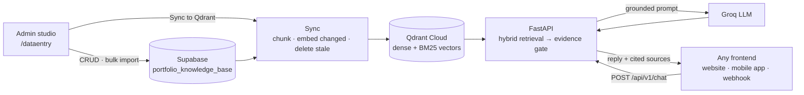

# AI Knowledge Assistant

<!-- Replace OWNER/REPO in the CI badge with your GitHub repository. -->


[](LICENSE)

**A plug-and-play RAG chatbot you can drop into any website or app.** Write your
knowledge in a password-protected admin studio, sync it to a vector index with one
click, and call a single `POST /api/v1/chat` endpoint. Answers come **only** from your
content, with numbered citations, and an honest "not available" when your content
doesn't cover the question.

Runs entirely on free tiers: Supabase, Qdrant Cloud, Groq and Render or Railway. No paid
embedding API is needed, because embeddings are computed locally.

- 🗂️ **`/dataentry` admin studio**: a spreadsheet-style grid with one tab per category (Personal Details, Projects, FAQs, …), paste-from-Google-Sheets, bulk JSON import, a one-click **Sync to Qdrant** with live progress, and a built-in chat tester.
- 🔌 **One endpoint to integrate**: `{message, session_id?}` → `{reply, sources, session_id, latency_ms}`. Copy-paste snippets for cURL, `fetch()` and an embeddable widget are below.
- 🎯 **Grounded answers**: hybrid retrieval (dense + BM25, fused with RRF), an evidence gate, citations mapped to sources, and prompt-injection-resistant prompts.
- 🔁 **Idempotent sync**: only changed entries are re-embedded; edited or deleted entries never leave stale vectors behind.
- ⚙️ **Zero hardcoding**: the persona, title, models, collection and table names all come from one `.env` file.
- 📏 **Measured, not guessed**: a labelled benchmark and a CI quality gate back every retrieval choice.

## Contents

- [Architecture](#architecture)
- [Get your credentials](#get-your-credentials) (Groq · Qdrant Cloud · Supabase)
- [5-minute quickstart](#5-minute-quickstart)
- [Using the admin studio](#using-the-admin-studio)
- [Integrate with any frontend](#integrate-with-any-frontend) (cURL · JavaScript · embeddable widget)
- [API reference](#api-reference)
- [Deploy](#deploy) (Docker · Render · Railway)
- [Configuration](#configuration)
- [How it works](#how-it-works) · [Benchmarks](#benchmarks)
- [Security](#security) · [Testing](#testing) · [Troubleshooting](#troubleshooting)
- [Upgrading from v1](#upgrading-from-v1) · [Contributing](#contributing) · [License](#license)

## Architecture



| Layer | Technology |
|---|---|
| API + admin UI | FastAPI, Uvicorn; zero-build HTML + Tailwind (CDN) + vanilla JS |
| Source of truth | Supabase Postgres table, accessed over its REST API |
| Embeddings | FastEmbed `BAAI/bge-small-en-v1.5` (384-d) + `Qdrant/bm25`, computed locally on the CPU |
| Vector database | Qdrant Cloud (free tier) |
| LLM | Groq (default `llama-3.3-70b-versatile`) |

## Get your credentials

You need three free accounts. Each takes about two minutes. Dashboards change from time to
time; if a menu name differs slightly, look for the nearest equivalent.

### 1. Groq API key (the LLM)

1. Sign in at **[console.groq.com](https://console.groq.com)**.
2. Open **API Keys** → **Create API Key**, name it (for example `knowledge-assistant`), and copy it.
   It is shown only once.
3. In `.env`, set `GROQ_API_KEY=` to that key. Optionally pick another model from the console's
   **Models** page with `GROQ_MODEL=`.

### 2. Qdrant Cloud cluster (the vector index)

1. Sign up at **[cloud.qdrant.io](https://cloud.qdrant.io)** and create a cluster. The **Free** tier
   (1 GB) is plenty. Choose the region closest to where you'll deploy the API.
2. When the cluster is healthy, open it and copy its **cluster URL / endpoint**
   (`https://xxxx.<region>.<cloud>.cloud.qdrant.io`, port `6333`) into `QDRANT_URL=`.
3. Under the cluster's **API Keys**, create a key and copy it into `QDRANT_API_KEY=`.
4. Leave the collection to the app. `QDRANT_COLLECTION_NAME` (default `knowledge_base`) is created on the first sync.

### 3. Supabase project (the source of truth)

1. At **[supabase.com](https://supabase.com)**, choose **New project**: pick a name, a database password and a region.
2. When it's ready, open **SQL Editor** → **New query**, paste the whole of
   [`supabase/schema.sql`](supabase/schema.sql), and click **Run**. It is safe to re-run. It creates:
   - the `portfolio_knowledge_base` table (columns `id, category, title, content, url, active, sort_order, updated_at`, with the 7 categories enforced by a CHECK constraint)
   - its indexes and an `updated_at` trigger
   - one read-only view per tab (`"Personal_Details"`, `"Projects"`, …)
   - Row Level Security that lets public keys **read** but never write
3. Copy the **Project URL** (Project Settings → **Data API**, or the **Connect** button) into `SUPABASE_URL=`.
4. Under Project Settings → **API Keys**, copy a **secret** key (`sb_secret_…`), or the
   `service_role` key from the *Legacy API keys* tab, into `SUPABASE_SERVICE_ROLE_KEY=`.

> ⚠️ The service-role or secret key bypasses Row Level Security. It belongs on the server
> only. Never put it in a frontend, a mobile app or a public repository.
>
> ℹ️ The schema allows **public read access**, so other services can read the knowledge base with
> the publishable key. That includes inactive rows, so don't store anything private in it. If you
> don't need public reads, drop the `"Allow public read access…"` policy; the app itself only uses
> the server key.

## 5-minute quickstart

**Prerequisites:** Python 3.11+ and the three credentials above.

```bash
git clone https://github.com/OWNER/REPO.git && cd REPO
python -m venv .venv
source .venv/bin/activate            # Windows: .venv\Scripts\Activate.ps1
pip install -r requirements.txt      # or, with uv: uv venv && uv pip install -r requirements.txt
cp .env.example .env                 # Windows: copy .env.example .env
```

1. **Fill in `.env`**: the four credentials above, plus an `ADMIN_PASSWORD` of your choice:
   ```bash
   python -c "import secrets; print(secrets.token_urlsafe(24))"
   ```
2. **Start the server:**
   ```bash
   uvicorn app.main:app --reload --reload-dir app     # or: python app.py
   ```
   The first start downloads the embedding models (~70 MB) once.
3. **Open <http://localhost:8000/dataentry>** and sign in with your `ADMIN_PASSWORD`.
4. Click **Bulk JSON import** → **Load .json file** → choose
   [`data/sample_entries.json`](data/sample_entries.json) → **Import**. This adds 18 rows of a
   fictional engineer's portfolio across all seven tabs.
5. Click **Sync to Qdrant** and watch the three steps complete.
6. Open **Test endpoint** and ask *"What projects has Alex built?"*. You'll get a cited answer,
   and the retrieved source chunks appear under it.

Interactive API docs are at <http://localhost:8000/docs>.

## Using the admin studio

`GET /dataentry` serves a single-page admin UI. It needs no Node and no build step, and it
supports light and dark themes.

| Area | What it does |
|---|---|
| **Sign-in gate** | Checks `ADMIN_PASSWORD` and sets an HttpOnly, SameSite=Strict session cookie (12 h). Login is limited to 5 attempts per minute per IP. |
| **Tabs** | One tab per category (Personal Details, Work Experience, Technical Skills, Projects, Articles, Social Links, FAQs), with row counts and a dot when a tab has unsaved edits. |
| **Spreadsheet grid** | Every cell is editable in place (Order · ID · Title · Content · URL · Active). Columns, limits and validation come from `GET /api/v1/admin/schema`. Long content wraps and grows. Changed rows are marked *Edited* or *New* until saved. |
| **Add row / reorder** | **Add row** appends a row with the next free ID for the tab (`PRJ004`, `FAQ008`, …). The ▲▼ buttons move a row and renumber `sort_order`. |
| **Paste from a spreadsheet** | Copy rows from Google Sheets or Excel and paste anywhere in the grid. Columns are `id, title, content, url, active` (optionally `sort_order`), or include a header row in any order. Existing IDs are updated and new ones are added. `TRUE`/`FALSE` works for `active`. |
| **Save changes** | One click (or `Ctrl+S`) validates every edited row and writes them all to Supabase in one request. Errors jump you to the right tab and cell. The page warns before you leave with unsaved edits. |
| **Delete** | The 🗑 button deletes a saved row after confirmation, or removes an unsaved one. |
| **Bulk JSON import** | Paste or load a JSON array of rows (or a `{"records": [...]}` file). Existing IDs are updated. Up to 2,000 per import. |
| **Sync to Qdrant** | Saves any pending edits first, then runs the sync with live progress (Fetching Supabase → Generating embeddings → Upserting to Qdrant), and shows a badge with the last result. |
| **Test endpoint** | A chat drawer that calls the real `POST /api/v1/chat`, with session memory, latency, and the retrieved source chunks and their scores. |

### The knowledge base schema

One table, `portfolio_knowledge_base`, holds all seven tabs. One Pydantic model
([`app/models/knowledge.py`](app/models/knowledge.py)) mirrors it and drives the grid and the
Qdrant payload.

| Column | Type | Notes |
|---|---|---|
| `id` | text, primary key | For example `PER001`, `PRJ004`. Keep it stable: it's how re-imports update instead of duplicating. |
| `category` | one of the 7 tabs | `Personal_Details`, `Work_Experience`, `Technical_Skills`, `Projects`, `Articles`, `Social_Links`, `FAQs`. Also powers "list all *X*" questions. |
| `title` | text, ≤ 200, default `''` | Shown as the citation (the `id` is used when blank). |
| `content` | text, 1–20,000 | The fact itself, in complete sentences. Long content is chunked automatically. |
| `url` | text, default `''` | Empty or an `http(s)` link; returned with citations. |
| `active` | boolean, default `true` | `false` keeps the row in Supabase but removes it from search on the next sync. |
| `sort_order` | integer, default `0` | Position within the tab (the ▲▼ buttons manage it). |
| `updated_at` | timestamptz | Set by a trigger on every edit. |

Each tab also has a read-only view (for example `select * from "Projects"`) exposing
`id, title, content, url, active` in tab order, with `active` as `'TRUE'`/`'FALSE'`. That's
handy for spreadsheets or other services reading with the publishable key.

To use different categories, edit the `Category` list in `app/models/knowledge.py` and the
CHECK constraint and views in `supabase/schema.sql`; the grid's tabs follow automatically.

Writing tips: one fact per row; complete sentences, not labels; put the words people actually
search for in the title.

## Integrate with any frontend

The chat endpoint needs no key, and `ALLOWED_ORIGINS=*` (the default) lets any website call it.
Restrict it to your domains in production.

### cURL

```bash
curl -X POST https://your-app.example.com/api/v1/chat \
  -H "Content-Type: application/json" \
  -d '{"message": "How can I contact Alex?"}'
```

```json
{
  "reply": "Email alex@example.com or use the contact form on https://alex.example.com; Alex usually replies within two working days [1].",
  "sources": [
    {
      "entry_id": "FAQ001",
      "title": "How can I contact Alex Rivera?",
      "category": "FAQs",
      "url": "https://alex.example.com/contact",
      "snippet": "You can contact Alex Rivera by email at alex@example.com or through the contact form…",
      "score": 0.8123
    }
  ],
  "session_id": "3f2c9a0d1b7e4c5f8a6d2e1b0c9f7a3e",
  "latency_ms": 912.4,
  "debug": null
}
```

To continue the conversation, send back the `session_id`, and follow-ups such as *"and if I
use Google sign-in?"* are understood.

### JavaScript (`fetch`)

```javascript
const API_URL = "https://your-app.example.com/api/v1/chat";
let sessionId = null;

async function ask(message) {
  const res = await fetch(API_URL, {
    method: "POST",
    headers: { "Content-Type": "application/json" },
    body: JSON.stringify({ message, session_id: sessionId }),
  });
  const data = await res.json();
  if (!res.ok) throw new Error(data.error); // 422 / 429 / 503 share one error shape
  sessionId = data.session_id;
  return data; // data.reply, plus data.sources: [n] in the reply = data.sources[n-1]
}
```

### Embeddable chat widget

Paste this before `</body>` on any page and set `API_URL`. Replies are inserted with
`textContent`, so model output can never inject HTML into your site.

```html
<div id="kb-chat" style="position:fixed;bottom:20px;right:20px;z-index:9999;font:14px system-ui,sans-serif">
  <div id="kb-panel" style="display:none;flex-direction:column;width:340px;height:440px;margin-bottom:10px;background:#fff;color:#111;border:1px solid #ddd;border-radius:12px;box-shadow:0 10px 30px rgba(0,0,0,.15);overflow:hidden">
    <div id="kb-log" style="flex:1;overflow:auto;padding:12px;display:flex;flex-direction:column;gap:8px"></div>
    <form id="kb-form" style="display:flex;gap:6px;padding:8px;border-top:1px solid #eee">
      <input id="kb-input" placeholder="Ask a question…" maxlength="1000" style="flex:1;padding:8px;border:1px solid #ccc;border-radius:8px">
      <button style="padding:8px 12px;border:0;border-radius:8px;background:#111;color:#fff;cursor:pointer">Send</button>
    </form>
  </div>
  <button id="kb-toggle" aria-label="Open chat" style="float:right;width:52px;height:52px;border:0;border-radius:50%;background:#111;color:#fff;font-size:22px;cursor:pointer">💬</button>
</div>
<script>
  (() => {
    const API_URL = "https://your-app.example.com/api/v1/chat"; // ← your deployment
    const $ = (id) => document.getElementById(id);
    let sessionId = null;
    $("kb-toggle").onclick = () => {
      const panel = $("kb-panel");
      panel.style.display = panel.style.display === "flex" ? "none" : "flex";
      $("kb-input").focus();
    };
    const bubble = (text, mine) => {
      const el = document.createElement("div");
      el.textContent = text;
      el.style.cssText = "padding:8px 10px;border-radius:10px;max-width:85%;white-space:pre-wrap;" +
        (mine ? "align-self:flex-end;background:#111;color:#fff" : "align-self:flex-start;background:#f2f2f2");
      $("kb-log").append(el);
      $("kb-log").scrollTop = $("kb-log").scrollHeight;
      return el;
    };
    $("kb-form").onsubmit = async (event) => {
      event.preventDefault();
      const message = $("kb-input").value.trim();
      if (!message) return;
      $("kb-input").value = "";
      bubble(message, true);
      const reply = bubble("…", false);
      try {
        const res = await fetch(API_URL, {
          method: "POST",
          headers: { "Content-Type": "application/json" },
          body: JSON.stringify({ message, session_id: sessionId }),
        });
        const data = await res.json();
        if (!res.ok) throw new Error(data.error || res.statusText);
        sessionId = data.session_id;
        reply.textContent = data.reply;
      } catch (err) {
        reply.textContent = "Sorry, something went wrong: " + err.message;
      }
    };
  })();
</script>
```

On free hosting, instances sleep when idle and the first request can take 30–60 s. Show a
"waking up…" state and use a generous timeout.

## API reference

Interactive docs: `/docs` (Swagger UI) and `/redoc`.

| Method | Path | Auth | Purpose |
|---|---|---|---|
| `POST` | `/api/v1/chat` | rate-limited per IP | **Chat**: `{message, session_id?, history?}` → `{reply, sources, session_id, latency_ms}` |
| `GET` | `/health` | — | Liveness probe |
| `GET` | `/api/v1/health` | — | Which dependencies are configured (booleans only) and the active models |
| `GET` | `/dataentry` | — | Admin studio (the page holds no data; everything comes from the admin API) |
| `POST` | `/api/v1/admin/auth` · `/logout` | password · — | Start or end an admin session (HttpOnly cookie) |
| `GET` | `/api/v1/admin/schema` | admin session | JSON Schema of a knowledge entry |
| `GET` · `POST` | `/api/v1/admin/entries` | admin session | List entries · create one (`409` on a duplicate id) |
| `PUT` · `DELETE` | `/api/v1/admin/entries/{id}` | admin session | Update · delete one (`404` if missing) |
| `POST` | `/api/v1/admin/entries/bulk` | admin session | Upsert a JSON array of up to 2,000 entries |
| `POST` · `GET` | `/api/v1/admin/sync` | admin session | Run a sync · current stage and last report |
| `POST` | `/api/v1/webhook/sync` | `X-Webhook-Secret` | Same sync, for automation |
| `POST` | `/api/v1/chat/ask` | rate-limited | *Deprecated* v1 contract `{question, history}` → `{success, answer, sources}` |

**Chat request rules:** `message` is 1–1000 characters. `history` (optional, for stateless
clients) holds up to 20 turns with roles `user`/`assistant`, each 1–2000 characters, and
overrides the session memory. `[n]` in `reply` is `sources[n-1]`, and only cited chunks are
returned. Every response carries an `X-Request-ID` that matches the server log line.

**Sync report:**
```json
{"success": true, "total_entries": 16, "chunks_embedded": 2, "vectors_upserted": 2, "added": 1, "updated": 1,
 "removed": 0, "unchanged": 14, "reindexed": false, "duration_ms": 842.7, "finished_at": "2026-11-24T10:15:02Z", "error": null}
```

**Errors** always have the shape `{"success": false, "error": "<message>"}`. Validation errors
(422) add `details: [{"field", "message"}]` and never echo the submitted values.

| Status | When | Client action |
|---|---|---|
| `401` | Missing or wrong admin session or webhook secret | Sign in / fix the header |
| `403` | Sync called while `SYNC_ENABLED=false` | — |
| `404` / `409` | Entry not found / id already exists | — |
| `422` | Invalid body (`details` names each field) | Fix the request |
| `429` | Rate limit exceeded | Wait `Retry-After` seconds |
| `503` | Qdrant, Supabase, a model or Groq is unavailable or unconfigured | Wait `Retry-After` seconds |
| `500` | Unexpected bug (logged with the request id, never returned) | Report it |

## Deploy

All three options read the same environment variables as `.env`. After the first deploy,
open `/dataentry`, import your content and click **Sync to Qdrant**. Until the first sync,
every question gets the "not available" reply.

### Docker

```bash
docker build -t ai-knowledge-assistant .
docker run --env-file .env -p 8000:8000 ai-knowledge-assistant
```

The image bakes in the default embedding models, runs as a non-root user and honours `$PORT`.
Keep `.env` comments on their own lines: `--env-file` doesn't strip inline comments.

### Render

1. Push the repository to GitHub.
2. In Render, choose **New → Blueprint** and select the repository. [`render.yaml`](render.yaml) sets up
   a free web service with a `/health` check.
3. Fill in the variables marked `sync: false`. `ADMIN_PASSWORD` and `WEBHOOK_SECRET` are generated
   for you; read them in the service's **Environment** tab.
4. Visit `https://<your-service>.onrender.com/dataentry`.

Free instances have 512 MB of RAM and sleep after 15 idle minutes. The models and search stack
use about 330 MB, so keep `RERANKER_MODEL` empty on the free plan.

### Railway

1. **New Project → Deploy from GitHub repo**, then pick the repository. Railway detects the `Dockerfile`.
2. Under **Variables**, open the **Raw Editor** and paste your `.env` contents.
3. Under **Settings → Networking**, click **Generate Domain**, then visit `https://<domain>/dataentry`.

## Configuration

Everything lives in environment variables (a local `.env` is read automatically).
[`.env.example`](.env.example) documents every one.

| Variable | Default | Purpose |
|---|---|---|
| `GROQ_API_KEY` | — | **Required.** Groq API key |
| `QDRANT_URL` / `QDRANT_API_KEY` | — | **Required.** Qdrant Cloud cluster |
| `SUPABASE_URL` / `SUPABASE_SERVICE_ROLE_KEY` | — | **Required.** Supabase project (service-role or secret key, server-side only) |
| `ADMIN_PASSWORD` | — | **Required** for `/dataentry` and the admin API (they return 503 until it's set) |
| `APP_TITLE` | `AI Knowledge Assistant` | Name shown in the admin studio and the API docs |
| `ASSISTANT_PERSONA` | generic helper | Who the assistant is and how it speaks. Grounding and safety rules are always appended. |
| `NO_ANSWER_MESSAGE` | `That information is not available in the knowledge base.` | Exact reply when nothing relevant is found |
| `GROQ_MODEL` | `llama-3.3-70b-versatile` | Any Groq chat model |
| `QDRANT_COLLECTION_NAME` | `knowledge_base` | Created on the first sync |
| `SUPABASE_TABLE_NAME` | `portfolio_knowledge_base` | Must match `supabase/schema.sql` |
| `ALLOWED_ORIGINS` | `*` | Comma-separated CORS origins for the chat API |
| `RATE_LIMIT_PER_MINUTE` | `30` | Chat requests per client IP |
| `WEBHOOK_SECRET` | empty (off) | Enables `POST /api/v1/webhook/sync` |
| `SYNC_ENABLED` | `true` | `false` makes both sync endpoints return 403 |
| `EMBEDDING_MODEL` | `BAAI/bge-small-en-v1.5` | Any FastEmbed dense model (benchmarked best fit) |
| `EMBEDDING_QUERY_PREFIX` | model card | Override the query instruction |
| `SPARSE_MODEL` | `Qdrant/bm25` | Lexical retriever; empty means dense-only |
| `RERANKER_MODEL` | empty (off) | Optional cross-encoder (+~380 MB RAM) |
| `CHUNK_SIZE` | `1200` | Characters per chunk for long entries |
| `RETRIEVAL_TOP_K` / `RETRIEVAL_LIST_TOP_K` | `5` / `10` | Sources given to the LLM for normal / "list all *X*" questions |
| `RETRIEVAL_CANDIDATES` / `RRF_K` | `20` / `60` | Candidates per retriever / fusion constant |
| `RETRIEVAL_SCORE_THRESHOLD` / `RERANK_SCORE_THRESHOLD` | `0.45` / `-11.0` | Evidence-gate floors (benchmarked) |
| `MAX_CONTEXT_TOKENS` | `3000` | Context budget for the LLM |
| `LLM_TEMPERATURE` / `LLM_TIMEOUT_SECONDS` / `LLM_MAX_RETRIES` | `0.2` / `30` / `3` | Generation and retry behaviour |
| `HISTORY_MAX_TURNS` | `6` | Turns kept per session and used to resolve follow-ups |
| `APP_ENV` | `development` | `production` = INFO logs and `Secure` cookies |
| `API_PREFIX` | `/api/v1` | Prefix for every API route |
| `RAG_DEBUG` | `false` | Adds the retrieval trace to chat responses (development only) |
| `PRELOAD_MODELS` | `true` | Warm the models in the background at startup |

Changing `EMBEDDING_MODEL`, `SPARSE_MODEL`, `EMBEDDING_QUERY_PREFIX` or `CHUNK_SIZE` re-embeds
everything on the next sync (and recreates the collection if the vector size changes).

## How it works

**Sync** ([`sync_service.py`](app/services/sync_service.py)):
1. Read the active entries from Supabase.
2. Split long content into chunks on paragraph and sentence boundaries.
3. Fingerprint each entry.
4. Embed only the changed entries.
5. Delete every point of a changed or removed entry by `entry_id`, then upsert its new chunks.

Re-running a sync with no changes does nothing, and an entry that shrinks from three chunks
to one leaves no stale vectors behind.

**Chat** ([`retrieval_service.py`](app/services/retrieval_service.py)):
1. Rewrite follow-ups into standalone queries, using the conversation only to resolve "it" or "that".
2. Detect "list all *X*" questions against the categories actually in your index.
3. Run dense, BM25 and category-filtered searches in one Qdrant round-trip, then fuse them with
   Reciprocal Rank Fusion.
4. Drop weak evidence.
5. Generate with a grounding prompt that treats sources as untrusted data.
6. Renumber the citations so `[n]` matches `sources[n-1]`.

Full map with layer rules and request flows: **[CODEBASE_MAP.md](CODEBASE_MAP.md)**.

## Benchmarks

```bash
python -m benchmarks.evaluate --configs production   # retrieval metrics: offline, local models
python -m benchmarks.evaluate --generation           # live answer quality (uses Groq quota)
```

The shipped benchmark has 29 hand-labelled questions over the fictional portfolio in [`data/sample_entries.json`](data/sample_entries.json),
in [`benchmarks/eval-cases.json`](benchmarks/eval-cases.json): exact names, paraphrases, typos,
"list all *X*" questions, multi-part questions, and out-of-scope or injection attempts.

| Production config, sample data | Hit@5 | Recall@5 | MRR | nDCG@5 | Answerable questions refused |
|---|---|---|---|---|---|
| Hybrid + category routing (default) | **1.000** | **0.979** | **0.979** | **0.963** | **0%** |

The pipeline was tuned on a private 51-case benchmark from its first deployment, where it
moved Hit@5 from 0.889 to **0.978**, MRR from 0.819 to **0.941**, and the share of returned
sources that are relevant from 0.30 to **0.97**. See [docs/](docs/rag-improvement-roadmap.md).
To benchmark your own content, point `BENCH_CORPUS` and `BENCH_CASES` at your files; the
docstring of [`benchmarks/evaluate.py`](benchmarks/evaluate.py) explains how.

## Security

- **Secrets** live only in environment variables. `/api/v1/health` reports booleans, never values, and logs never contain keys, passwords, question text or retrieved content.
- **The admin password** is compared in constant time, and login is limited to 5 attempts per minute per IP.
- **Admin sessions** are HMAC-signed with a per-process secret mixed with the password, so a stolen cookie can't be used to brute-force the password offline, and changing the password signs everyone out. The cookie is HttpOnly, SameSite=Strict, scoped to `/api/v1/admin` and `Secure` in production.
- **The admin page** forbids framing (`X-Frame-Options: DENY`) and renders every value with `textContent`, never as HTML.
- **Supabase** RLS lets public keys read the table and its views but never write. The per-tab views use `security_invoker`, so they can't be used to bypass RLS. Only the server's secret key can write.
- **Untrusted input:** retrieved content and conversation history are treated as data. The prompt forbids following instructions inside them, and history is never used as evidence.
- **Validation:** inputs are validated at the boundary (length limits, id and URL patterns, role allow-list), and the chat is rate-limited per IP.

Signing in again is needed after a server restart; sessions are kept in memory by design.

## Testing

```bash
pip install -r requirements-dev.txt
ruff check . && ruff format --check .    # lint + formatting
pytest                                   # ~200 offline tests, a few seconds, no keys or downloads
RUN_MODEL_TESTS=1 pytest                 # + real models and the retrieval-quality gate
```

The offline suite uses a fake embedder, an in-memory Qdrant, a mocked Supabase (httpx
`MockTransport`) and a stubbed LLM. It cannot reach a real service, even if your `.env` is present.

## Troubleshooting

| Symptom | Likely cause / fix |
|---|---|
| `/dataentry` says *Admin password is not configured* | Set `ADMIN_PASSWORD` and restart |
| *Table 'portfolio_knowledge_base' not found…* | Run [`supabase/schema.sql`](supabase/schema.sql) in the Supabase SQL Editor |
| *Supabase rejected the key (HTTP 401/403)* | You used the anon or publishable key; use the service-role or secret key |
| Every answer is "not available" | No sync since deploying or changing models: click **Sync to Qdrant** |
| Chat returns `503` | Check `/api/v1/health` for which dependency is unconfigured; read the server log for the request id |
| `503` and logs show `Groq HTTP 429; retrying` | Groq free-tier rate limit; clients should honour `Retry-After` |
| Signed out unexpectedly | The server restarted (free tiers sleep when idle); sign in again |
| Browser shows a CORS error | Add your site's origin to `ALLOWED_ORIGINS` |
| A wrong or odd answer | Set `RAG_DEBUG=true` locally and inspect `debug.candidates` (ranks, scores, gate) |

## Upgrading from v1

v1 was a single-portfolio chatbot that read a JSON file from Supabase Storage.

1. **Rename environment variables:**
   - `APP_NAME` → `APP_TITLE`
   - `FRONTEND_ORIGINS` → `ALLOWED_ORIGINS`
   - `SUPABASE_SECRET_KEY` → `SUPABASE_SERVICE_ROLE_KEY`
   - `LLM_API_KEY` → `GROQ_API_KEY`
   - `LLM_MODEL` → `GROQ_MODEL`
   - `ADMIN_API_TOKEN` → `ADMIN_PASSWORD`
   - Remove `LLM_PROVIDER` (Groq only).
2. **Keep the old behaviour, if you want it**, by setting `ASSISTANT_PERSONA` and `NO_ANSWER_MESSAGE` to your previous wording.
3. **Move your data:**
   1. Run `supabase/schema.sql`.
   2. Open `/dataentry` → **Bulk JSON import**, and load your old knowledge-base JSON. The `{"records": [...]}` format with `url`/`active` keys imports unchanged.
   3. Click **Sync to Qdrant**. Existing vectors keep answering until that first sync replaces them.
4. **Frontends** using `POST /api/v1/chat/ask` keep working through the deprecated alias. Move them to `POST /api/v1/chat` when convenient.

## Contributing

Contributions are welcome. See [CONTRIBUTING.md](CONTRIBUTING.md).

## License

[MIT](LICENSE) © 2026 Suraj Kumar Yadav
