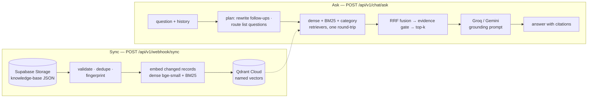

# Portfolio RAG Chatbot

<!-- Replace OWNER/REPO in the CI badge with your GitHub repository. -->
[](https://github.com/OWNER/REPO/actions/workflows/ci.yml)


[](LICENSE)

A retrieval-augmented chatbot backend for a personal portfolio that runs entirely on
free tiers. Visitors ask questions; answers come **only** from a curated knowledge
base, with numbered citations — and an honest "not available" when the knowledge
base doesn't say.

- **Hybrid retrieval** — local dense embeddings (FastEmbed `bge-small`) + BM25, fused with Reciprocal Rank Fusion in one Qdrant round-trip
- **Grounded answers** — strict grounding prompt, `[n]` citations mapped to returned sources, refusals for out-of-scope questions
- **Conversations** — follow-up questions ("what latency does *it* achieve?") resolved from client-side history; the server stores nothing
- **Incremental sync** — only changed records are re-embedded; triggered by GitHub Actions or a Supabase webhook
- **Measured, not guessed** — a 51-case hand-labelled benchmark; every retrieval choice is backed by numbers ([docs](docs/rag-improvement-roadmap.md))
- **Free-tier friendly** — runs on Render free (512 MB), Qdrant Cloud free, Groq free tier; no paid embedding API

## Contents

- [Architecture](#architecture)
- [Project structure](#project-structure)
- [Quick start](#quick-start)
- [Configuration](#configuration)
- [Knowledge base format](#knowledge-base-format)
- [API reference](#api-reference)
- [Deploying to Render](#deploying-to-render)
- [Keeping the knowledge base in sync](#keeping-the-knowledge-base-in-sync)
- [Testing & benchmarks](#testing--benchmarks)
- [Security](#security)
- [Troubleshooting](#troubleshooting)
- [Contributing](#contributing) · [License](#license)

## Architecture



| Layer | Technology |
|---|---|
| API | FastAPI, Uvicorn |
| Knowledge source | JSON file in Supabase Storage |
| Embeddings | FastEmbed `BAAI/bge-small-en-v1.5` (384-d, local CPU) |
| Lexical search | FastEmbed `Qdrant/bm25` sparse vectors |
| Vector database | Qdrant Cloud (free tier) |
| LLM | Groq (default) or Gemini, over plain HTTPS |
| Hosting | Render (free tier) |

## Project structure

Full map with layer rules and request flow diagrams: **[CODEBASE_MAP.md](CODEBASE_MAP.md)**.

```text
app/
  api/          routes_chat.py, routes_sync.py, dependencies.py (auth, rate limit)
  core/         config.py (settings), exceptions.py (error contract), logging.py
  models/       chat.py, sync.py — Pydantic request/response schemas
  services/     data_fetcher, embedding, qdrant, query, retrieval, rerank, llm, sync
  main.py       entry point: middleware, routers, exception handlers, health probes
benchmarks/     labelled evaluation set, metrics, runner, results
docs/           architecture assessment, benchmark baseline, improvement roadmap
examples/       sample knowledge base to get started
postman/        Postman collection with built-in tests
scripts/        initialize_qdrant, manual_sync
tests/          offline unit/integration tests + opt-in real-model gate
.github/        CI and scheduled-sync workflows
```

## Quick start

**Prerequisites:** Python 3.11+, a free [Qdrant Cloud](https://cloud.qdrant.io) cluster,
a [Groq](https://console.groq.com) API key, and a [Supabase](https://supabase.com) project.

```bash
git clone https://github.com/OWNER/REPO.git && cd REPO
python -m venv .venv
source .venv/bin/activate          # Windows: .venv\Scripts\Activate.ps1
pip install -r requirements-dev.txt
cp .env.example .env               # Windows: copy .env.example .env
```

1. Fill in `.env` (see [Configuration](#configuration)).
2. In Supabase Storage, create a bucket `portfolio-knowledge-base` and upload your
   knowledge base as `Portfolio_Knowledge_Base.json` — start from
   [`examples/Portfolio_Knowledge_Base.sample.json`](examples/Portfolio_Knowledge_Base.sample.json).
3. Start the API and index the knowledge base:

```bash
python app.py                                   # http://127.0.0.1:8000/docs
curl -X POST http://127.0.0.1:8000/api/v1/admin/sync -H "x-admin-token: $ADMIN_API_TOKEN"
curl -X POST http://127.0.0.1:8000/api/v1/chat/ask \
  -H "Content-Type: application/json" -d '{"question": "What projects are in the portfolio?"}'
```

## Configuration

All settings are environment variables (a local `.env` is read automatically). Only
the first block is required; everything else has a benchmarked default.

| Variable | Default | Purpose |
|---|---|---|
| `SUPABASE_URL` / `SUPABASE_SECRET_KEY` | — | Knowledge-base source. The secret key bypasses RLS: server-side only |
| `QDRANT_URL` / `QDRANT_API_KEY` | — | Qdrant Cloud cluster |
| `LLM_PROVIDER` / `LLM_API_KEY` | — | `groq` or `gemini`, and its key |
| `ADMIN_API_TOKEN` | — | Secret for `/admin/sync` (manual) |
| `WEBHOOK_SECRET` | — | Secret for `/webhook/sync` (automation) |
| `FRONTEND_ORIGINS` | `http://localhost:5173` | Comma-separated CORS origins |
| `QDRANT_COLLECTION_NAME` | `portfolio_knowledge` | Collection name |
| `LLM_MODEL` | provider default | e.g. `openai/gpt-oss-120b` on Groq |
| `LLM_TEMPERATURE` / `LLM_TIMEOUT_SECONDS` / `LLM_MAX_RETRIES` | `0.2` / `30` / `3` | Generation and retry behaviour |
| `EMBEDDING_MODEL` | `BAAI/bge-small-en-v1.5` | Dense model (benchmarked best fit) |
| `EMBEDDING_QUERY_PREFIX` | model card | Override the query instruction |
| `SPARSE_MODEL` | `Qdrant/bm25` | Lexical retriever; empty = dense-only |
| `RERANKER_MODEL` | empty (off) | Optional cross-encoder; doesn't fit 512 MB |
| `RETRIEVAL_CANDIDATES` | `20` | Candidates per retriever |
| `RETRIEVAL_TOP_K` / `RETRIEVAL_LIST_TOP_K` | `5` / `10` | Sources for normal / "list all X" questions |
| `RRF_K` | `60` | Fusion constant |
| `RETRIEVAL_SCORE_THRESHOLD` | `0.45` | Dense cosine floor (benchmarked) |
| `RERANK_SCORE_THRESHOLD` | `-11.0` | Reranker floor (calibrated for MiniLM-L-6) |
| `MAX_CONTEXT_TOKENS` | `3000` | Context budget for the LLM |
| `HISTORY_MAX_TURNS` | `6` | Turns used to resolve follow-ups |
| `RATE_LIMIT_PER_MINUTE` | `30` | `/chat/ask` requests per client IP |
| `SYNC_ENABLED` | `true` | `false` makes both sync endpoints return 403 |
| `RAG_DEBUG` | `false` | Adds the retrieval trace to responses (development only) |
| `PRELOAD_MODELS` | `true` | Warm models in the background at startup |
| `APP_ENV` | `development` | `production` = INFO logging, no auto-reload |

Changing `EMBEDDING_MODEL`, `SPARSE_MODEL` or `EMBEDDING_QUERY_PREFIX` changes the
*embedding version*: queries only match vectors of the current version, so run a
sync afterwards (it re-embeds everything, and recreates the collection if needed).

## Knowledge base format

One JSON file with a flat `records` array. Each record is one self-contained fact:

```json
{
  "records": [
    {
      "id": "PRJ001",
      "category": "Projects",
      "title": "Tidewatch — Open-Source Uptime Monitor",
      "content": "Tidewatch is an open-source uptime monitor built with FastAPI and HTMX...",
      "url": "https://example.com/tidewatch",
      "active": true
    }
  ]
}
```

- `id` must be stable — changing it is treated as delete + add.
- `category` must be one of `Personal_Details`, `Work_Experience`, `Technical_Skills`,
  `Projects`, `Articles`, `Social_Links`, `FAQs`; all seven must appear at least once
  or sync fails loudly instead of indexing a partial file.
- `content` is what the chatbot reads — write complete sentences, not labels.
- `active: false` hides a record without deleting it. Editing any field re-indexes that record.

## API reference

Interactive docs: `/docs` (Swagger UI) and `/redoc`. A ready-made
[Postman collection](postman/Portfolio-Chatbot.postman_collection.json) tests every endpoint.

| Method | Path | Auth | Description |
|---|---|---|---|
| `GET` | `/health` | — | Liveness probe |
| `GET` | `/api/v1/health` | — | Configured dependencies and active models (no secrets) |
| `GET` | `/api/v1/chat/status` | — | Chat readiness |
| `POST` | `/api/v1/chat/ask` | rate-limited | Ask a question |
| `POST` | `/api/v1/webhook/sync` | `X-Webhook-Secret` | Sync, for automation |
| `POST` | `/api/v1/admin/sync` | `x-admin-token` | Sync, for manual use |

### Ask a question

```bash
curl -X POST "$BASE_URL/api/v1/chat/ask" \
  -H "Content-Type: application/json" \
  -d '{"question": "How often does it check endpoints?",
       "history": [{"role": "user", "content": "What is Tidewatch?"},
                   {"role": "assistant", "content": "Tidewatch is an uptime monitor [1]."}]}'
```

```json
{
  "success": true,
  "answer": "Tidewatch checks each endpoint every minute [1].",
  "sources": [{"category": "Projects", "title": "Tidewatch — Open-Source Uptime Monitor", "url": "https://example.com/tidewatch"}],
  "debug": null
}
```

- `question`: 1–1000 characters. `history` (optional): up to 20 turns, roles `user`/`assistant`, 2000 characters each.
- `[n]` in the answer is `sources[n-1]`; only cited records are returned.
- Out-of-scope questions return `"That information is not available in the portfolio knowledge base."` with `sources: []`.
- Every response carries `X-Request-ID`, matching the server log line.

### Trigger a sync

```bash
curl -X POST "$BASE_URL/api/v1/webhook/sync" -H "X-Webhook-Secret: $WEBHOOK_SECRET"
```

```json
{"success": true, "added": 0, "updated": 1, "removed": 0, "unchanged": 34, "reindexed": false, "error": null}
```

### Errors

Every error has the same shape: `{"success": false, "error": "<message>"}`. Validation
errors (422) add `details` naming each failing field — the submitted values are never echoed:

```json
{"success": false, "error": "Invalid request.",
 "details": [{"field": "history.0.role", "message": "Input should be 'user' or 'assistant'"}]}
```

| Status | When | Client action |
|---|---|---|
| `401` | Missing or wrong admin token / webhook secret | Fix the header |
| `403` | Sync called while `SYNC_ENABLED=false` | — |
| `422` | Invalid request body | Fix the request |
| `429` | More than `RATE_LIMIT_PER_MINUTE` requests | Wait `Retry-After` seconds |
| `503` | Qdrant, Supabase, a model or the LLM is unavailable (incl. Groq rate limits after retries) | Wait `Retry-After` seconds |
| `500` | Unexpected bug (details are logged, never returned) | Report it |

<details>
<summary>PowerShell equivalents</summary>

```powershell
Invoke-RestMethod -Method Post -Uri "$env:BASE_URL/api/v1/chat/ask" `
  -ContentType "application/json" -Body '{"question": "What projects are in the portfolio?"}'
Invoke-RestMethod -Method Post -Uri "$env:BASE_URL/api/v1/webhook/sync" `
  -Headers @{ "X-Webhook-Secret" = $env:WEBHOOK_SECRET }
```
</details>

### Frontend integration

```javascript
const history = []; // [{role: "user" | "assistant", content: string}], kept client-side

async function askChatbot(question) {
  const res = await fetch(`${BACKEND_URL}/api/v1/chat/ask`, {
    method: "POST",
    headers: { "Content-Type": "application/json" },
    body: JSON.stringify({ question, history: history.slice(-6) }),
  });
  if (!res.ok) throw new Error(`Chatbot request failed (${res.status})`);
  const data = await res.json();
  history.push({ role: "user", content: question }, { role: "assistant", content: data.answer });
  return data; // render [n] as links to data.sources[n-1]
}
```

Render free instances sleep after 15 idle minutes — show a "waking up" state and use a
60 s+ timeout. Never put any key or token in frontend code; `BACKEND_URL` is all it needs.

## Deploying to Render

1. Push the repository to GitHub.
2. In Render: **New → Blueprint**, select the repository. [`render.yaml`](render.yaml)
   configures the service (Uvicorn on `$PORT`, health check on `/health`).
3. Fill in the variables marked `sync: false`: `FRONTEND_ORIGINS` (your deployed
   frontend), Supabase, Qdrant, LLM, `ADMIN_API_TOKEN`, `WEBHOOK_SECRET`.
4. After the deploy is live, run one sync (`POST /api/v1/webhook/sync`). Until the first
   sync, `/chat/ask` returns `503`.
5. Check `https://<your-app>.onrender.com/api/v1/health` and the memory graph: the
   models and search stack add ~330 MB. Keep `RERANKER_MODEL` empty on the free plan.

**Upgrading from a pre-hybrid version:** the collection moves from one unnamed vector
to named `dense` + `bm25` vectors. The first sync detects the old schema, recreates
the collection and re-indexes from Supabase; until then `/chat/ask` returns `503`.

## Keeping the knowledge base in sync

Sync is idempotent — unchanged records are skipped — so triggering it often is cheap.

- **GitHub Actions (included):** [`.github/workflows/sync.yml`](.github/workflows/sync.yml)
  calls the webhook every 6 hours and on demand. Add repository secrets
  `SYNC_WEBHOOK_URL` (`https://<your-app>.onrender.com/api/v1/webhook/sync`) and
  `SYNC_WEBHOOK_SECRET` (same value as `WEBHOOK_SECRET`). It retries through Render cold starts.
- **Supabase Database Webhook:** uploads are rows in `storage.objects`, so a database
  webhook on that table can POST to `/api/v1/webhook/sync` with the `X-Webhook-Secret`
  header whenever the file is replaced.
- **Manually:** `POST /api/v1/admin/sync` or `python -m scripts.manual_sync`.

Render Cron Jobs would also work but are a paid feature.

## Testing & benchmarks

```bash
ruff check . && ruff format --check .    # lint + formatting
pytest                                   # ~120 offline tests, seconds, no keys needed
RUN_MODEL_TESTS=1 pytest                 # + real models and the retrieval-quality gate
```

The offline suite uses a fake embedder, in-memory Qdrant and a stubbed LLM. The
real-model gate fails if benchmark quality drops below the production numbers.

```bash
python -m benchmarks.evaluate --configs production   # retrieval metrics (offline)
python -m benchmarks.evaluate                        # every ablation / model / reranker
python -m benchmarks.evaluate --generation           # live answer quality (uses LLM quota)
```

Measured on a 51-case hand-labelled benchmark (details in [docs/](docs/rag-improvement-roadmap.md)):

| | Original pipeline | Current |
|---|---|---|
| Retrieval Hit@5 / MRR / nDCG@5 | 0.889 / 0.819 / 0.761 | **0.978 / 0.941 / 0.883** |
| "List all X" recall@5 | 0.36 | **0.65** |
| Answerable questions refused | 9.5% | **0%** |
| Facts present in answers | 0.905 | **1.00** |
| Returned sources that are relevant | 0.30 | **0.97** |

To benchmark your own content, replace `benchmarks/corpus.json` with a snapshot of your
knowledge base and relabel `benchmarks/rag-evaluation.json`.

## Security

- Secrets live only in environment variables; `/api/v1/health` reports booleans, never values.
- Admin and webhook secrets are compared in constant time; separate secrets let you rotate automation credentials independently.
- The webhook ignores the request body — sync always re-reads Supabase — so forged payloads can't inject content.
- Retrieved content and conversation history are treated as untrusted data; the prompt forbids following instructions inside them, and history is never used as evidence.
- CORS is restricted to `FRONTEND_ORIGINS`; `/chat/ask` is rate-limited per IP.
- Logs carry request ids and timings, never question text, keys or headers; the Gemini key is sent as a header because httpx logs URLs.

## Troubleshooting

| Symptom | Likely cause |
|---|---|
| `/chat/ask` returns `503` right after deploy | No sync has run yet (or the collection still has the old schema) — trigger a sync |
| Every answer is "not available"; log: `No indexed documents for the current embedding version` | Models changed since the last sync — trigger a sync |
| Sync returns `success: false` with `missing required category` | A category was renamed or removed in the JSON |
| Sync returns `Supabase Storage request failed` | Wrong URL/key, or bucket/file not named exactly as above |
| `503` with logs `Groq HTTP 429; retrying` | Free-tier tokens/minute exhausted; the client should honour `Retry-After` |
| Wrong answer | Set `RAG_DEBUG=true` locally and inspect `debug.candidates` (ranks, scores, gate) |

## Contributing

Contributions are welcome — see [CONTRIBUTING.md](CONTRIBUTING.md).

## License

[MIT](LICENSE) © 2026 Suraj Kumar Yadav
